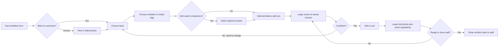

# Miora 2026 → 2027: breakfast growth, photo differentiation & causal journey graph

Date: 2026-11-11. Source of menu truth: `dist/menu-data.js`, `dist/kiosk-data.js`, `dist/photo-data.js`, `dist/photos.js`, `dist/app.js`. **This is a product analysis and implementation brief, not authorization to add menu items or alter food photography.**

## Verified baseline
- The published catalog contains **93** products across **8** categories.
- **27** products are mapped onto **11** distinct shared photo sources; **8** additional positions use known placeholder photos (not counted in the 27).
- Category counts: hot coffee 21; iced coffee 9; hot drinks 8; cold drinks 9; desserts 24; water/soft drinks 5; smoothies/fresh 2; food & bakery 15.
- The breakfast configurator already exists under `recipes.breakfast`: do not create a conflicting second recipe. `r.image=431203`. The published catalog entry "Breakfast plate" (`431203`) is 450 TRY.
- Breakfast bases: large croissant plate **450 TRY**, mini croissant plate **400 TRY**, sliced bread plate **350 TRY**. Egg: omelette **or** boiled (exactly one). Sweets: tahini–molasses, honey, Nutella (up to three). Additional bread **+20 TRY** or mini croissant **+40 TRY**, up to two add-on types. The recipe includes greens, tomato, cucumber, avocado, cheese, green and black olives, breakfast sauce and walnuts. **Do not offer salmon, pancakes, extra cheese, egg recipes, or any unconfirmed ingredients as free breakfast components.**
- The smart sandwich has first-step food hero, filling-aware preview, final review, and full-width cart photography. Breakfast still lacks analogous live and cart photography; generic custom-order cart rows remain compact.

## Duplicate media clusters requiring differentiation

The clusters below are **confirmed source-level reuse**, not a computer-vision claim that all photos look the same.

| Shared photo ID | Distinct products | Product IDs | Distinction that must be communicated |
|---|---:|---|---|
| 428759 | 6 | 428759, 428985, 429233, 429239, 429243, 429244 | Mocha, Lotus, white chocolate, salted caramel, caramel macchiato, pumpkin spice; use honest flavor accent, not the same mocha frame |
| 429271 | 5 | 429271, 429277, 429282, 429286, 429287 | Iced mocha, salted caramel, caramel, hazelnut, vanilla; clear flavor chip + distinct photo |
| 428748 | 4 | 428748, 428787, 428981, 429151 | Plain, caramel, hazelnut, vanilla latte; distinguish by recipe/label, no fabricated topping |
| 428743 | 2 | 428743, 428977 | Americano vs filter coffee; extraction method rather than same cup photo |
| 428961 | 2 | 428961, 428979 | Cortado vs flat white; scale/ratio, not invented quantities |
| 428974 | 2 | 428974, 428976 | Single vs double espresso; different cup scale or explicit shot count |
| 429252 | 2 | 429252, 429294 | Iced Americano vs cold brew; brew method and ice vs extraction |
| 429301 | 2 | 429301, 429303 | Matcha plain vs syrup version; clear variation without invented flavor |
| 430236 | 2 | 430236, 431178 | Wholegrain vs plain sourdough; replace borrowed bread photo |
| Other | 2 groups ×2 | See `photo-data.js` | Audit the mapping and exact source against real dish image |

**No-photo placeholders (8):** `431314` mini cheesecake, `430199` banana magnolia, `430227` brownie ball, `431294` chocolate muffin, `430203` éclair, `431747` muffin, `431748` gluten-free poğaça, `431749` gluten-free vegetable bun. Get owner photos before marketing these as actual dishes.

Media acceptance: if a new image is generative, mark "AI serving concept" in RU/TR/EN, never present it as an actual Miora dish. Request owner verification for real plating/packaging. Don't clone a product photo across different ingredients and present as reality.

## Proposed breakfast journey: one visually coherent dish

1. **Interest:** on the home/menu breakfast surface, show large real Miora breakfast photo or clearly labelled AI concept. CTA "Build your breakfast" and a secondary "Popular ideas".
2. **Fast start:** choose one of three valid bases. The picture changes to chosen croissant size / sliced bread; do not force a second full-screen page.
3. **Choose egg:** omelette vs boiled. Show *specific illustration* only if it truthfully represents egg choice; otherwise keep generic restaurant breakfast photo plus selected-option captions.
4. **Sweet companions:** optional and visually secondary: honey, tahini/molasses, Nutella. Add sweet spots only where generated assets actually depict those exact items and owner's serving is confirmed.
5. **Extra bakery:** extra bread / mini croissant with visible charge before selecting. No arbitrary combo discount.
6. **Review:** large 3:2 breakfast plate media, exact localized components including inherent plate ingredients, itemized options, total, clear "illustrative" copy.
7. **Cart:** full-width photo per custom breakfast, chips for selections and exact 1×/2× and "edit". Staff-facing mode remains compact and scannable.

### Causal / temporal decision graph

**Causal hypotheses (testable, not proven):**
- Visual distinctiveness → lower product identity confusion → more informed choice.
- Large and relevant food photo → stronger appetite motivation, but inaccurate AI photo → trust loss, complaints or refunds.
- Optional presets → reduced first-decision burden → higher builder starts.
- Live state echo on every step → higher perceived control → fewer backtracks.
- Honest prices + exact composition → lower checkout uncertainty.
- Huge sticky images on short mobile displays → obstructed options → worse completion; cap and dynamically compress preview height.
- Strongly personalized cross-sell after order is stabilized → possible basket increase; too early cross-sell → decision fatigue.

### Spatial/temporal UX constraints
- 320, 360, 390, 430 px widths, keyboard and screen reader, dark theme, TR/RU/EN, desktop.
- Hero image is 3:2; on a short device screen cap to 180–220 CSS px. Other steps use compact sticky preview approx 96–140 px; keep next action and current price visible.
- Keep all images `width`/`height`, lazy-load below fold, priority-load only visible first hero, WebP/AVIF. Avoid scroll jumps on selection, quantity change, or image swap.
- Respect `prefers-reduced-motion`; no animated confetti by default.
- No paid checkout is available: site generates a staff-facing order; do not claim "pay now" or invented discounts.

## 2026 research → 2027 experiment hypotheses
- DoorDash/SevenRooms 2026 reports that appealing menu photography influenced consumer meal choice and that menus with >=50% photo coverage had ~13% average sales lift *on DoorDash*. This is platform observational data, **not a causal forecast for Miora**.
- DoorDash 2026: 65% of consumers report that remembering preferences affects visit frequency; 59% value allergen or dietary info, supporting clearly readable labels rather than fake nutrition claims.
- Toast 2026: diners show willingness to use AI for discovery and menu recommendations, but many do not seek AI in every dining step.
- **2027 predictions, not observed facts:** context-sensitive presets, visual change previews, trust-first generative asset workflows, ingredient-aware bundle suggestions, privacy-minimal engagement tracking.

References:
- https://about.doordash.com/en-us/news/doordash-restaurant-industry-trends-report-2026
- https://sevenrooms.com/research/restaurant-trends/
- https://pos.toasttab.com/blog/data/restaurant-trends
- https://www.barandrestaurant.com/operations/table-phone-menu-engineering-2026

## Instrumentation / validation
Event funnel: `breakfast_hero_view`, `breakfast_builder_start`, `breakfast_preset_selected`, `breakfast_base_selected`, `breakfast_egg_selected`, `breakfast_optional_selected`, `breakfast_review_open`, `breakfast_order_added`, `cart_view`, `staff_view`.
Capture only anonymous aggregate event counts and optional session-scoped identifiers with owner-approved consent/privacy rules. Do not collect food sensitivities or persist personal preference profiles without user agreement.

Primary metrics: (starts/hero views), (valid completions/starts), (orders/reviews), (staff-view/cart), change/reversal rate by step, image failures, CLS, INP, transfer weight and p95 render time. Compare cohorts or randomized A/B traffic; **no asserted uplift before measurement**.

## Implementation milestones
1. **P0: breakfast safe UX** — add labeled large intro/live preview/review/cart using already published real assets, exact valid choices, tests for all 3×2 base/egg combinations and reset/edit/qty. No invented ingredient or price.
2. **P1: owner-approved image matrix** — make 6 accurate base+egg shots + optional sweet additions, align branding, include owner confirmation and image provenance. Two concept examples exist but are **not** approved product photography.
3. **P1: duplicate-source cleanup** — fix 3 biggest hot/iced coffee groups first; request or shoot 8 placeholders. Explicitly mark missing until replaced.
4. **P2: ranked category browsing** — distinct adjacent photo sources (when ranking within a section) while preserving explicit user search and favorites. No hidden paid rankings.
5. **P2: analytics** — consent-respecting funnel, performance SLOs and conversion experiment.

**Release gate:** no new photographed ingredients in an AI image unless supported by the actual recipe; no hidden pricing change; TR/RU/EN checked; CI green; mobile test across 320–430px; confirm with owner before replacing actual café product photos.
