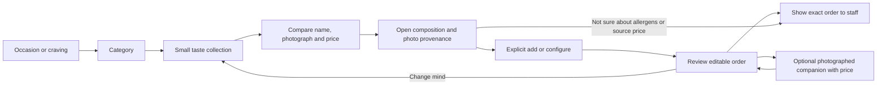

# Miora: desire, choice and trust graph

Verified 2026-11-12 against the published site and the captured 2026-11-05 source catalog. This is an editorial decision graph, not a learned preference model or a forecast of sales.

## Actual problem

All **93/93** source products already rendered in their real **8/8** categories. Desserts contained **24/24** products. The apparent absence was a discovery/media problem, not confirmed stock loss: long one-photo-per-screen posts, logo placeholders, and poor comparison of recipes. Current availability is not connected to the website.

Of 93 positions, 54 use previously reviewed, AI-restyled source-menu images; 30 use source originals that had been served as 400px thumbnails; 9 have no confirmed product photograph (8 known logo placeholders plus 1 null image). Those 9 positions remain readable and actionable without invented product pictures.

## Implemented graph

The optional companion is never preselected or added automatically. Coffee can lead to San Sebastian, and a dessert/meal to cappuccino, only if the complementary broad category is absent. Both are existing priced items with photography; no claimed discount. The staff step explicitly remains an unsent order list, not payment or a transmitted order.

## Paths for all categories

- Hot coffee, **21**: coffee classics → milk coffees → flavours → matcha.
- Iced coffee, **9**: black/chilled → milk and flavour over ice.
- Hot drinks, **8**: tea → Turkish coffee → warming drinks.
- Cold drinks, **9**: refreshment → milkshakes/chai → iced matcha.
- Desserts, **24**: cheesecakes → cups/layers → cakes/brownies/little bites → éclairs/tart/pancakes.
- Water/soft drinks, **5**: water/sparkling → milk/juice.
- Smoothies/fresh, **2**: a fruity break, both products visible together.
- Food/bakery, **15**: sandwiches → breakfast → bakery.

Collections are jump destinations within the **complete** category, not additional filters that hide products. Each item occurs exactly once. Search and favorites keep their precise membership and order. Unknown future products fall into a visible remainder instead of silently disappearing. Category URLs can be opened and refreshed directly.

## Media and presentation

Downloaded the **same 30 original CDN objects**, without the `/resize/400x0/` transformation; preserved source URL, SHA-256 and native dimensions in `original-photo-refresh-2026-11-12.json`. Examples: Strawberry Magnolia **1179×1115**, Raspberry Cheesecake **900×1600**. New WebP variants use 160/360/640/1200 width targets, capped at native resolution, proportional resizing only, no crop/upscale/generative replacement. Each file is capped below 350 KB. Originals are preserved as source identities, while already reviewed illustration assets remain separately labelled. Retouched variants still disclose their AI-restyled provenance in product details.

Food is shown at a comparison-friendly size, with a persistent name, price and add/build action; photographs open composition. Reused source photos within a collection are shown once, with remaining distinct recipe variants represented by truthful flavor labels rather than cloned images pretending to be new photographs. Bottles use contain; portrait food has reviewed focal positions. No-photo details and feed cards use readable typography, not an enlarged logo image. Image failure falls back to the packaged source JPEG and then a readable no-photo state; ingredients remain accessible.

The long builder gallery is now opt-in inspiration. Direct sandwich and Breakfast 2.0 buttons remain immediately available. The three original Instagram links remain in the inspiration panel, breakfast step/product details and dessert context; a social video no longer precedes actual dessert choices. No autoplay or third-party loading is added. Favorites use an explicit heart; image taps open details. Unnecessary simulated social-post chrome and visible local view counters are removed from menu cards. No synthetic popularity, stock urgency, dietary benefit or conversion claims.

## Verification

- **43** integrity tests: every source position/category/price, order arithmetic, configured recipes, journey coverage, preserved search/favorite ordering, original-photo hashes/dimensions, no upscaling, unique actual-width srcset descriptors, file-size budget.
- Catalog and photo-index regeneration, JavaScript syntax, whitespace checks.
- Chromium **12** viewport/language combinations: 320/390/768/1280 × RU/TR/EN; every one checks all 8 categories and 93 product identities. Touch navigation on mobile widths. All collection jumps are visibly below sticky controls; no page overflow, missing local responses, uncaught errors or third-party requests. Scoped axe checks cover product catalog/build entry for every category; dark-theme catalog is checked too.
- Full flow: photo → composition → add Strawberry Magnolia → optional cappuccino → order persistence; favorites/search reset; direct breakfast builder and saved configured order. Unknown source price cannot become a regular add action.
- Separate Retina check validates the selected actual source-file pixel dimensions against displayed size, not density-normalized `naturalWidth`. Injected media failures verify WebP → source JPEG → readable card. Interactive graph node/category controls are exercised.
- Browser tests are desktop Chromium emulation, not physical-device tests. No Lighthouse score, real conversion increase, current stock or independent human acceptance is claimed. PR CI, Pages deployment and post-deploy tests are separate delivery evidence.

## Owner photo queue

- Cold drinks: `429448` Iced Chai Tea Latte.
- Desserts: `431314` Mini Cheesecake, `430199` Banana Magnolia, `430227` Brownie Bite, `431294` Chocolate Muffin, `430203` Éclair.
- Food/bakery: `431747` Muffin, `431748` Gluten-free Poğaça, `431749` Gluten-free Vegetable Bun. Names are retained from the menu; allergen suitability is not independently certified.

These are missing photography, not confirmed unavailable dishes. New owner photographs can replace the no-photo states without changing product identity or price.

## Measurement proposed, not enabled

Potential future funnel: category → collection → composition → add → cart → staff-view; reversal/edit rate; image failures; transfer and interaction performance. Real stock, margins, sales and preference analytics are not connected. An owner-approved experiment is needed before claiming that the sequence improves commercial outcomes.
